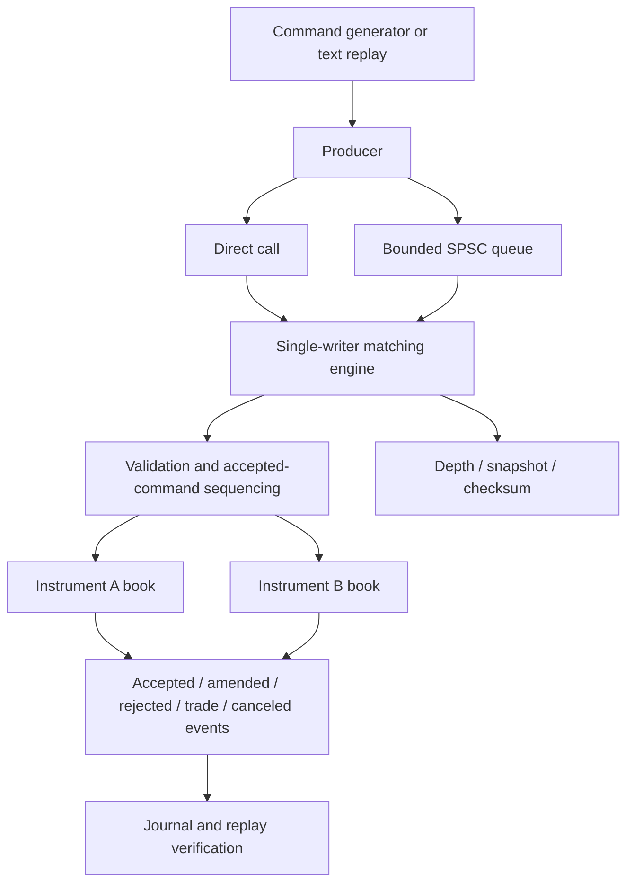

# Architecture and engineering decisions

## Ownership and processing

The producer performs syntax/range validation before ingestion. The engine performs authoritative semantic validation against current book state on the owner thread, so duplicate IDs and amendments observe all preceding commands. Direct processing is the baseline. The queued runner transfers ownership to a dedicated worker and returns ownership only after join. There are no book locks.

Each command completes before another starts. Event order is acceptance or amendment, followed by zero or more trades, followed by residual cancellation when applicable. Explicit cancellation generates one cancellation event. A rejection generates one event and makes no state change. Each trade identifies both the taker and maker and records both remaining quantities. No wall-clock timestamps or random IDs enter matching or serialization.

## Data structures and complexity

Each instrument has descending bid and ascending ask maps. Each level contains an aggregate quantity and FIFO list. A global unordered index maps live IDs to the book, level pointer and list iterator. Map node and list iterator stability permits direct indexed removal. Handles are deleted before their referenced orders disappear. Empty levels are removed immediately.

| Operation | Complexity |
|---|---|
| Best bid/ask | O(1) |
| ID lookup | Expected O(1) |
| Add to an existing level | O(log P) level lookup, then O(1) FIFO append and expected O(1) index insertion |
| Add a new level | O(log P) plus allocations |
| Cancel indexed order | Expected O(1); O(log P) when removing an empty level by price |
| Match | Proportional to makers filled and level removals, plus expected O(1) index operations |
| FOK check | O(number of eligible levels visited) |
| Snapshot/checksum | O(active orders + instruments) |

The proposal describes existing-level insertion as O(1) on average. With its prescribed ordered maps, locating that level is O(log P); this implementation documents the actual bound. Expected hash-map bounds are not worst-case guarantees. Matching traverses only the best opposite level and FIFO head. FOK subtracts available quantities from the required amount to avoid overflow when liquidity spans multiple large levels.

An overflow check runs before accepting a resting GTC addition or replacement. For a same-price amendment it excludes the order's current remaining quantity. Because a valid book is uncrossed, an incoming GTC order at an existing same-side price cannot first consume opposite liquidity at that price; the check does not reject an otherwise executable residual solely because it checks the submitted quantity.

## Allocation experiment

`EngineConfig::allocation` selects baseline per-node allocation or an unsynchronized pool. Both modes retain identical data structures, validation and matching. The order index and event vector can be reserved at construction. The index may still grow past its reserve, and a single command that sweeps many makers may grow the event vector.

Modern libraries route allocator-aware containers through `std::pmr::unsynchronized_pool_resource`. On older Apple libc++ lacking `<memory_resource>`, a portable allocator forwards to the same resource abstraction. Its pool rounds small allocations into sixteen size classes, allocates 128-node chunks, and recycles freed nodes through lists. Oversized or over-aligned allocations go directly upstream. Pool chunks are retained until engine destruction. This improves reuse at the cost of retained memory and size-class padding; performance reports include regressions as well as improvements.

Counting resources distinguish logical container allocations from actual upstream allocations and track current/peak requested bytes. Counts exclude ordinary metadata allocations and the event vector. RSS captures broader process usage but is a process-lifetime maximum. The comparison reserves the same index capacity in both modes and generates inputs once outside timing. These measurements test the allocation hypothesis; they do not claim cycle-level CPU profiling or prove the allocator is every workload's bottleneck.

Allocation exhaustion is an exceptional process failure. There is no transactional rollback guarantee after `std::bad_alloc` during matching, event generation or insertion; callers should stop processing that engine and reconstruct from commands. Ordinary validation rejections are non-mutating. Reserves are capacity hints, not hard limits or a bounded-memory guarantee.

## Concurrency

The SPSC queue has exactly the advertised usable capacity, plus one internal sentinel slot. A producer publishes a slot with a release store; a consumer acquires that index before reading. The consumer releases its tail after copying, and the producer acquires the tail before reusing storage. Head/tail are aligned separately to reduce false sharing. Payloads are trivially copyable.

`run_queued()` retries full queues with `yield()`. No overwrite, loss or reordering occurs. At EOF the producer publishes completion; the worker rechecks after acquiring completion and drains all remaining commands before exiting. Worker exceptions signal the producer to stop; join completes and rethrows on the caller. This is SPSC, not a multi-producer API. The caller must combine multiple input sources before the queue or build a separate ingestion layer. A blocking consumer callback can delay shutdown; the library does not forcibly terminate threads.

## Replay and snapshots

`LOB_COMMANDS 1` is a strict versioned text input. `LOB_JOURNAL 1` records instruments, commands, ordered events and a checksum after each command. To verify, replay the original commands and byte-compare the reconstructed journal, including intermediate checksums. The CLI reads the input completely before execution, so malformed trailing text does not execute an unnoticed prefix. CLI journaling buffers the complete output and computes O(N) checksums; it is intended for simulation and verification, not latency measurement.

JSON snapshots include instrument definitions, accepted sequence, cumulative traded volume, all live orders in deterministic book/FIFO order, aggregates, and checksum. They are export/inspection artifacts, not restart checkpoints. Recovery reconstructs from the command stream; snapshot import is outside this implementation.

The checksum is versioned FNV-1a over explicit little-endian 64-bit fields: schema version, engine sequence, two volume words, instrument count and definitions, order count, and canonical orders. It never hashes padding, addresses, unordered iteration, native endianness, or decimal floating point. It is a reproducibility checksum, not a cryptographic digest. Sequence exhaustion rejects further commands. With fewer than 2^64 accepted commands and each command trading at most 2^64−1 units, cumulative volume fits in 128 bits.

## Scope

The implementation covers the in-memory simulator described in the proposal. Networking, durable write-ahead recovery, fees, accounts, credit limits, stop orders, auctions, self-trade prevention, exchange connectivity and distributed replication are outside that proposal's defined scope. Instrument definitions remain fixed for an engine's lifetime. The command-line interface exposes depth via JSON snapshots, and the C++ API exposes immediate depth/quote queries after each command.
