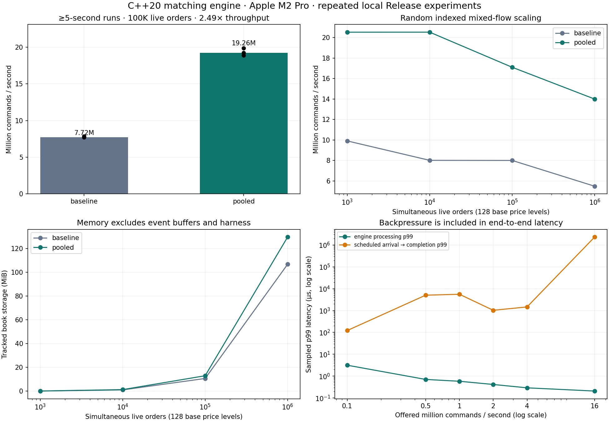

# Project results at a glance

Measured on **Apple M2 Pro**, macOS-26.5.2-arm64-arm-64bit, C++20 Release (`-O3 -DNDEBUG`). Values below come from three repetitions per configuration; throughput and percentile headlines use medians, not the fastest run.

| Achievement | Measured result | Evidence |
|---|---|---|
| Multi-second mixed-flow throughput | **19.26 million commands/s**, sampled p99 **0.166 µs**, 100,000 live orders across four instruments | Three runs per allocator, each at least five seconds |
| Allocation optimization | **2.49× throughput** (149.5% increase) vs baseline on the same random-access workload | Alternating allocator trial order |
| Capacity | **1,000,000 simultaneous live orders**; 14.00 million commands/s in the fixed-batch scale test | 129.7 MiB tracked book allocation, excluding harness and other process memory |
| Differential correctness | **1,000,000 random commands**, 20 seeds, **2,000,000 engine/oracle comparisons**, zero mismatches | Events, full state, depth, quotes and invariants checked after every command |
| Deterministic reconstruction | **1,000,000 commands replayed**, matching event hashes and final state for every seed | Independent fresh-engine replay |
| Queue integrity under offered load | **141,600,000 commands**, no observed loss or duplication | Ordinals checked individually, exact counts and book accounting checked after drain |

The unit suite also has **54 passing Google Tests**, including workload-accounting and percentile tests. See [validation](validation.md) for sanitizer outcomes; these performance experiments are Release runs.



## Sustained random-access mixed flow

All 100,000 base orders remain live at the end. Uniform random cancellation/amendment targets span the base order IDs. A 200,000-command prepared batch repeats for at least five seconds per run. All commands in these benchmark runs are accepted; expiration is an accepted lifecycle outcome.

| Allocator | Runs | Commands/s, millions (min–max) | Sampled p50 µs | Sampled p99 µs | Minimum measured duration s | Measured commands | System allocations/command | Tracked book MiB |
|---|---:|---:|---:|---:|---:|---:|---:|---:|
| baseline | 3 | 7.719 (7.712–7.877) | 0.125 | 0.416 | 5.001 | 116,600,000 | 1.250000 | 10.69 |
| pooled | 3 | 19.257 (18.881–19.886) | 0.042 | 0.166 | 5.006 | 290,600,000 | 0.000000 | 13.00 |

Allocation counts cover instrument price maps, FIFO nodes and ID-index storage. Pool metadata, event buffers and harness allocations are excluded. Zero measured upstream allocations means those tracked resources made no new system allocation requests after warm-up; it does not mean zero memory use or a blanket zero-allocation API guarantee.

## Scaling with live order count

Each row measures a fixed 200,000-command batch after warm-up. Four instruments and 128 total base price levels remain constant; the varied dimension is the live order count. This isolates indexed access and FIFO removal from growth in the number of price levels. Targets are uniform across the live ID range; each finite batch touches a subset of those IDs. This is not a proof of asymptotic complexity.

| Live orders | Allocator | Throughput, M commands/s (min–max) | Sampled p99 µs | Tracked book MiB | Tracked bytes/live order |
|---:|---|---:|---:|---:|---:|
| 1,000 | baseline | 9.912 (9.789–9.917) | 0.250 | 0.12 | 125.3 |
| 1,000 | pooled | 20.523 (20.487–21.018) | 0.125 | 0.16 | 165.7 |
| 10,000 | baseline | 8.016 (7.907–8.536) | 0.292 | 1.08 | 113.3 |
| 10,000 | pooled | 20.526 (19.623–20.884) | 0.125 | 1.33 | 139.3 |
| 100,000 | baseline | 8.005 (7.777–8.305) | 0.375 | 10.69 | 112.1 |
| 100,000 | pooled | 17.100 (17.011–17.411) | 0.209 | 13.00 | 136.3 |
| 1,000,000 | baseline | 5.488 (4.873–5.926) | 0.917 | 106.82 | 112.0 |
| 1,000,000 | pooled | 13.996 (13.915–15.432) | 0.250 | 129.73 | 136.0 |

## Queue latency at controlled offered rates

The producer schedules arrivals at the offered rate for two seconds. The 4,096-slot queue retries when full. End-to-end latency starts at the intended arrival time, so it includes producer scheduling delay, full-queue backpressure, queue wait and processing. Delayed requests retain their original scheduled times, avoiding the bias from starting a timer only after successful enqueue. All offered commands are eventually drained; preserving commands under overload can coexist with a large latency backlog.

| Offered M commands/s | Completed M commands/s (min–max) | Sampled service p99 µs | Sampled end-to-end p50 µs | Sampled end-to-end p99 µs | Full-queue retries | Max observed occupancy | Lost commands |
|---:|---:|---:|---:|---:|---:|---:|---:|
| 0.1 | 0.100 (0.100–0.100) | 3.167 | 0.625 | 121.750 | 0 | 272 | 0 |
| 0.5 | 0.500 (0.500–0.500) | 0.708 | 0.709 | 5056.709 | 19,116 | 4,096 | 0 |
| 1.0 | 1.000 (1.000–1.000) | 0.583 | 0.750 | 5565.875 | 8,526 | 4,096 | 0 |
| 2.0 | 2.000 (2.000–2.000) | 0.416 | 0.584 | 1029.459 | 35,152 | 4,096 | 0 |
| 4.0 | 4.000 (4.000–4.000) | 0.292 | 0.875 | 1469.042 | 171,082 | 4,096 | 0 |
| 16.0 | 7.362 (7.183–7.473) | 0.208 | 1201114.334 | 2323617.521 | 10,005,607 | 4,096 | 0 |

At 16M offered commands/s, completed throughput was 7.36M/s and sampled end-to-end p99 was 2.324 seconds. This overload point quantifies the latency cost of retrying and draining every command.

Queue throughput includes draining after the offered interval. Rates with large end-to-end tails should not be described as low-latency capacity. This local producer/consumer test includes OS scheduling and excludes network and disk I/O.

## Correctness and replay evidence

- 1,000,000 source commands: 966,998 accepted and 33,002 deliberate/expected rejections; 129,337 trade events.
- Baseline and pooled engines each compared with a separately implemented flat-vector reference matcher after every command: 2,000,000 state comparisons and 2,000,000 invariant checks.
- Random tests use small books for exhaustive per-command comparison (observed maximum 21 live orders). The million-live-order capacity claim comes from the separate scale experiments.
- All 20 seeds replayed into a fresh engine with identical ordered-event hashes, full final snapshots and checksums. Seed-specific values are in the raw JSON.
- Across all performance configurations: 553,600,000 measured commands; rejected benchmark commands and lost queued commands both zero. Warm-up and initial population are additional, untimed operations.

## How to present this project

Use the bullets in [resume.md](resume.md) and show the chart above. In an interview, explain the tradeoff: single-writer ownership gives deterministic matching; indexed FIFO removal makes random cancellation practical; pooling improves allocation reuse, while retained memory and queue backlog remain measurable costs. These are measured local experiments, not production exchange traffic.

## Reproduce and audit

```sh
cmake -S . -B build -DCMAKE_BUILD_TYPE=Release
cmake --build build -j 4
ctest --test-dir build --output-on-failure
python3 scripts/run_impact.py
python3 scripts/impact_report.py
```

The evidence suite runs experiments sequentially. A smoke version is available with `python3 scripts/run_impact.py --quick --output build/impact-smoke`; smoke results are not accepted for resume report generation.

Raw artifacts: [manifest and source hashes](../benchmarks/impact-results/manifest.json), [sustained measurements](../benchmarks/impact-results/sustain.csv), [differential/replay results](../benchmarks/impact-results/stress.json). The directory also contains scale and offered-rate CSVs. The manifest records compiler flags, CPU/OS, exact invocation and source SHA-256 values.

Method limits: three repetitions do not provide a confidence interval. Measurements use a monotonic clock with one latency sample every 127 commands (prime stride distributes samples across the eight operation positions). Percentiles are nearest rank; table percentile values are medians of each run's sampled percentile. Timer overhead is not subtracted. The workload is synthetic and repeats a seeded batch; it is not a calibrated exchange feed. There is no CPU pinning or frequency control. Tracked memory is not total RSS. Warm-up and input generation occur before timing. Throughput includes statistics and sampling overhead. All conservation, state and invariant verification occurs after performance timing.
