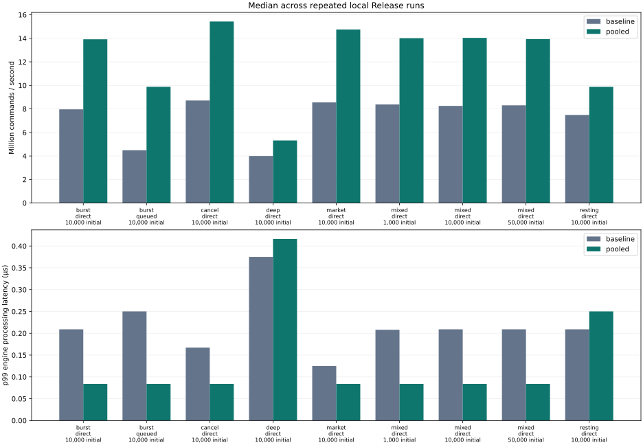

# Measured performance

These are local measurements, not the proposal's engineering targets.

## Environment

```json
{
  "os": "macOS-26.5.2-arm64-arm-64bit",
  "architecture": "arm64",
  "logical_cpus": 10,
  "compiler": "Apple clang version 14.0.3 (clang-1403.0.22.14.1)",
  "build_type": "Release",
  "CMAKE_BUILD_TYPE": "Release",
  "CMAKE_CXX_COMPILER": "/usr/bin/c++",
  "CMAKE_CXX_FLAGS_RELEASE": "-O3 -DNDEBUG",
  "hardware": {
    "chip_type": "Apple M2 Pro",
    "machine_model": "Mac14,9",
    "machine_name": "MacBook Pro",
    "number_processors": "proc 10:6:4:0",
    "physical_memory": "16 GB"
  }
}
```

## Results

Throughput and percentiles are medians of the recorded repetitions. Throughput range includes every run; maximum latency is the largest sample across all repetitions.

| Profile | Mode | Initial orders | Allocator | Runs | M commands/s (range) | p50 µs | p95 µs | p99 µs | Max µs | System allocations/command | Peak book MiB |
|---|---|---:|---|---:|---:|---:|---:|---:|---:|---:|---:|
| burst | direct | 10,000 | baseline | 3 | 7.967 (7.223–8.038) | 0.083 | 0.208 | 0.209 | 53.708 | 1.50000 | 1.83 |
| burst | direct | 10,000 | pooled | 3 | 13.918 (13.917–14.086) | 0.042 | 0.084 | 0.084 | 13.958 | 0.00000 | 2.08 |
| burst | queued | 10,000 | baseline | 3 | 4.487 (4.120–4.599) | 0.084 | 0.209 | 0.250 | 16.000 | 1.50000 | 1.83 |
| burst | queued | 10,000 | pooled | 3 | 9.880 (7.643–11.497) | 0.042 | 0.084 | 0.084 | 131.750 | 0.00000 | 2.08 |
| cancel | direct | 10,000 | baseline | 3 | 8.717 (8.408–8.817) | 0.083 | 0.125 | 0.167 | 31.083 | 1.50000 | 1.83 |
| cancel | direct | 10,000 | pooled | 3 | 15.429 (15.344–15.540) | 0.042 | 0.042 | 0.084 | 22.875 | 0.00000 | 2.08 |
| deep | direct | 10,000 | baseline | 3 | 4.001 (3.970–4.052) | 0.208 | 0.292 | 0.375 | 127.708 | 2.95052 | 20.57 |
| deep | direct | 10,000 | pooled | 3 | 5.319 (4.869–5.427) | 0.166 | 0.209 | 0.416 | 61.542 | 0.02304 | 23.89 |
| market | direct | 10,000 | baseline | 3 | 8.552 (8.461–8.642) | 0.083 | 0.125 | 0.125 | 30.166 | 1.50000 | 1.83 |
| market | direct | 10,000 | pooled | 3 | 14.752 (14.566–14.772) | 0.042 | 0.083 | 0.084 | 33.833 | 0.00000 | 2.08 |
| mixed | direct | 1,000 | baseline | 3 | 8.377 (8.015–8.413) | 0.083 | 0.167 | 0.208 | 30.417 | 1.50000 | 0.87 |
| mixed | direct | 1,000 | pooled | 3 | 14.012 (12.861–14.056) | 0.042 | 0.084 | 0.084 | 106.042 | 0.00000 | 0.91 |
| mixed | direct | 10,000 | baseline | 3 | 8.257 (8.257–8.310) | 0.083 | 0.167 | 0.209 | 13.208 | 1.50000 | 1.83 |
| mixed | direct | 10,000 | pooled | 3 | 14.040 (13.994–14.201) | 0.042 | 0.084 | 0.084 | 19.708 | 0.00000 | 2.08 |
| mixed | direct | 50,000 | baseline | 3 | 8.306 (8.128–8.486) | 0.083 | 0.167 | 0.209 | 44.750 | 1.50000 | 6.11 |
| mixed | direct | 50,000 | pooled | 3 | 13.936 (13.851–14.243) | 0.042 | 0.084 | 0.084 | 4.667 | 0.00000 | 7.27 |
| resting | direct | 10,000 | baseline | 3 | 7.486 (5.828–8.192) | 0.083 | 0.125 | 0.209 | 95.208 | 2.00032 | 11.75 |
| resting | direct | 10,000 | pooled | 3 | 9.875 (9.858–11.781) | 0.042 | 0.084 | 0.250 | 79.125 | 0.01562 | 14.28 |

## Allocation comparison

Ratios compare medians on identical generated inputs. Values below 1.0 indicate a regression in throughput.

| Profile | Mode | Initial orders | Pooled / baseline throughput | Baseline / pooled system allocations per command |
|---|---|---:|---:|---:|
| burst | direct | 10,000 | 1.747× | 1.50000 / 0.00000 |
| burst | queued | 10,000 | 2.202× | 1.50000 / 0.00000 |
| cancel | direct | 10,000 | 1.770× | 1.50000 / 0.00000 |
| deep | direct | 10,000 | 1.330× | 2.95052 / 0.02304 |
| market | direct | 10,000 | 1.725× | 1.50000 / 0.00000 |
| mixed | direct | 1,000 | 1.673× | 1.50000 / 0.00000 |
| mixed | direct | 10,000 | 1.700× | 1.50000 / 0.00000 |
| mixed | direct | 50,000 | 1.678× | 1.50000 / 0.00000 |
| resting | direct | 10,000 | 1.319× | 2.00032 / 0.01562 |

### Observations

- For mixed flow with 10,000 initial orders, pooling changed median throughput by 1.700× and p99 from 0.209 to 0.084 µs. Peak tracked book memory changed from 1.83 to 2.08 MiB.
- Tail regression: deep / direct / 10,000 initial orders had median p99 0.375 µs with baseline allocation and 0.416 µs with pooling. Chunk refill and scheduling are possible contributors; these samples do not isolate their individual effects.
- Tail regression: resting / direct / 10,000 initial orders had median p99 0.209 µs with baseline allocation and 0.250 µs with pooling. Chunk refill and scheduling are possible contributors; these samples do not isolate their individual effects.

## Method and limits

- Release C++20, steady clock, 2,000 add/cancel warm-up pairs, then initial book population. Input generation and population are outside measurement.
- Every command is timed; percentile uses nearest rank. Throughput includes clock calls, event counting and latency collection. Percentiles measure engine processing, including event generation, excluding queue wait.
- Queued throughput includes producer, backpressure retries, worker startup and queue draining. Queue capacity is 4,096. No commands are intentionally dropped.
- Baseline and pooled modes use the same map/list/hash design and pre-reserve the index for the full input size. Repetitions alternate allocator order. This isolates node allocation effects; it is not a comparison against a different matching algorithm.
- PMR uses the standard unsynchronized pool where available. Older Apple libc++ selects the portable 128-node chunk pool. Pooling reduces calls to the system allocator but retains freed chunks and may regress latency or memory usage.
- Allocation counts cover book maps, FIFO lists, and the order index. Event-vector growth, engine metadata, pool metadata, generated inputs and measurement buffers are excluded. Peak book bytes include warm-up and index reservation.
- CSV also records process peak RSS in bytes. It is a process-lifetime high-water mark, so later rows can inherit earlier peaks; use book-resource bytes for per-engine comparisons.
- Queue maximum occupancy is sampled by the producer and may miss a short-lived peak. Full retries count retry attempts, not unique blocked commands.
- No CPU pinning, frequency control or hardware isolation was used. OS scheduling and background work affect tails; these results do not establish hard real-time guarantees.
- Workloads are synthetic. Cancellation and market profiles pair insertion with removal; mixed flow uses an eight-command lifecycle cycle. These are controlled allocation/matching experiments rather than a calibrated exchange feed. Individual 100,000-command runs are short; throughput is not a long-duration soak-test result. Very short latencies are affected by clock quantization and timer overhead.
- Across these runs: 0 rejected commands, 0 dropped commands, 246,175 queue-full retries; largest observed queue occupancy 4,096.
- All repetitions and both allocation modes produced the same final checksum for each workload configuration.

## Reproduction

```sh
cmake -S . -B build -DCMAKE_BUILD_TYPE=Release
cmake --build build -j 4
./build/lob_bench --commands 100000 --repeats 3 --active-orders 10000 --output benchmarks/results/main.csv
./build/lob_bench --commands 100000 --repeats 3 --active-orders 1000 --profile mixed --output benchmarks/results/mixed-1000.csv
./build/lob_bench --commands 100000 --repeats 3 --active-orders 50000 --profile mixed --output benchmarks/results/mixed-50000.csv
python3 scripts/benchmark_report.py benchmarks/results/*.csv --output docs/performance.md
```

Python chart generation requires Matplotlib (`python3 -m pip install matplotlib`). The C++ project has no Python runtime dependency.


